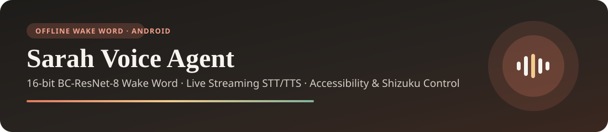
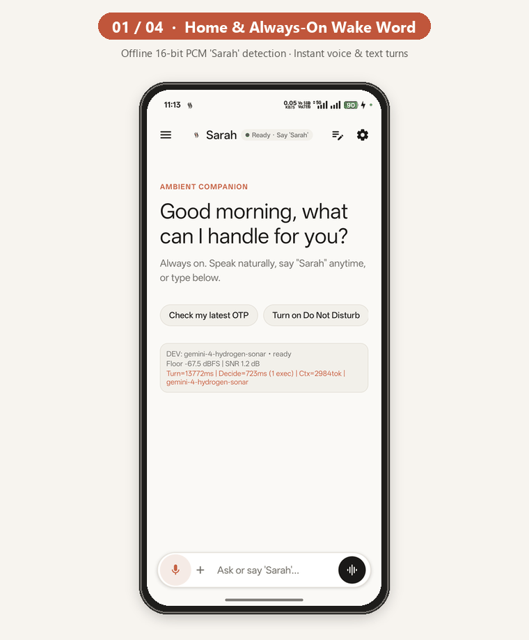
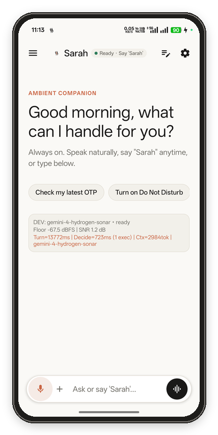
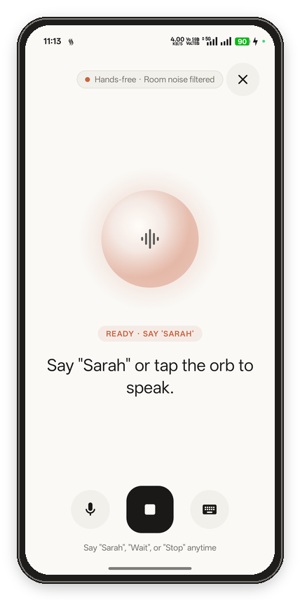
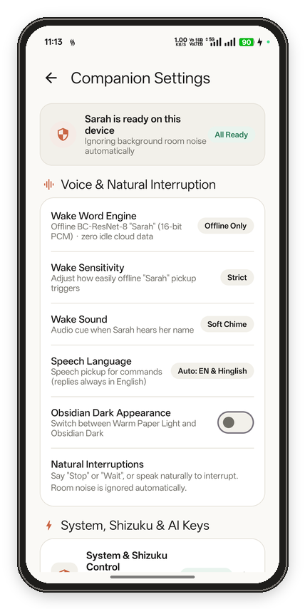
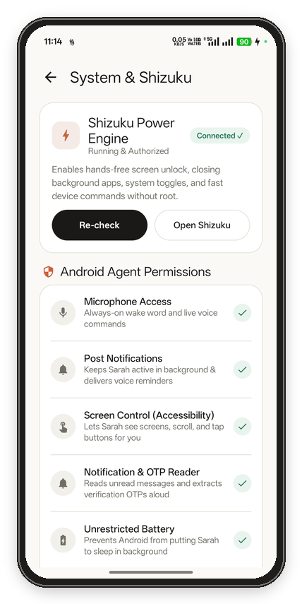

<div align="center">



<br />


<br />

[](https://developer.android.com)
[](https://kotlinlang.org)
[](https://onnxruntime.ai)
[](https://shizuku.rikka.app)

<br /><br />

[](https://github.com/Sumit3972/sarah-voice-agent/releases/latest/download/sarah-v1.0.0-release.apk)
[](https://github.com/Sumit3972/sarah-voice-agent/releases)

</div>

---

**Sarah** is an open-source, hands-free **Android AI voice & screen action companion**. It listens locally on-device for `"Sarah"` using a tiny **284 KB offline `BC-ResNet-8` ONNX model** (zero cloud traffic while idle), streams low-latency speech-to-text, routes intent across **Mercury Decide / Mercury 3** and pooled **Google Antigravity Gemini** OAuth accounts, operates apps visually via **Android Accessibility Set-of-Marks Vision + Shizuku shell**, and replies aloud with **Fish Audio S2.1 Pro** expressive voice synthesis.

---

<h2 align="center">✨ App Showcase & Live UI Walkthrough</h2>

<div align="center">
  
</div>

<br />

<div align="center">
  <table width="100%">
    <tr>
      <td align="center" width="25%"><b>1 · Companion Home</b></td>
      <td align="center" width="25%"><b>2 · Live Voice Orb</b></td>
      <td align="center" width="25%"><b>3 · Offline Wake Settings</b></td>
      <td align="center" width="25%"><b>4 · System &amp; Shizuku</b></td>
    </tr>
    <tr>
      <td align="center"></td>
      <td align="center"></td>
      <td align="center"></td>
      <td align="center"></td>
    </tr>
    <tr>
      <td align="center"><sub>Always-on standby pill, quick actions &amp; live audio floor telemetry</sub></td>
      <td align="center"><sub>Hands-free voice orb with instant natural interruption (<code>"Stop"</code> / <code>"Wait"</code>)</sub></td>
      <td align="center"><sub>Strictly offline <code>BC-ResNet-8</code> wake engine, sensitivity &amp; Obsidian Dark toggle</sub></td>
      <td align="center"><sub>Rootless Shizuku power bridge, Accessibility &amp; OTP Notification Reader</sub></td>
    </tr>
  </table>
</div>

---

## 🧠 Architecture & Voice Pipeline

```mermaid
flowchart LR
    MIC["16 kHz · 16-bit PCM Mic"] --> PIP["AudioPipeline<br/>85Hz Biquad + Silero VAD"]
    PIP --> KWS["LocalWakeWordEngine<br/>Pure-Kotlin LogMel + BC-ResNet-8 ONNX<br/>(100% Offline Standby)"]
    KWS -- "Sarah detected" --> STT["Deepgram Realtime WS<br/>Nova-3 / Flux EN & Hinglish"]
    STT --> DEC["MercuryDecideRouter<br/>Intent & Tool Classifier"]
    DEC -- "Fast / Chat" --> M3["Mercury 3 Streaming"]
    DEC -- "Vision / Deep Tools" --> AGY["Antigravity OAuth Pool<br/>Gemini Quota Round-Robin"]
    M3 & AGY --> TOOLS["Android Tool Layer<br/>Accessibility Set-of-Marks · Shizuku · DeviceIntent · Room Memory"]
    TOOLS --> TTS["Fish Audio Live WS<br/>S2.1 Pro Expressive TTS"]
    TTS --> SPK["Speaker + Echo Barge-In Guard"]
```



### Key Highlights
- **100% Offline Wake Word ([LocalWakeWordEngine.kt](app/src/main/java/com/voiceagent/audio/LocalWakeWordEngine.kt) & [LogMelExtractor.kt](app/src/main/java/com/voiceagent/audio/LogMelExtractor.kt)):**
  - Captures 16 kHz signed **16-bit PCM**, applies RMS stabilization, 512-pt radix-2 FFT, 40-bin Slaney Mel filterbank (`20–7600 Hz`), per-utterance CMVN, and runs `assets/wakeword/sarah_wakeword_fp32.onnx` via `onnxruntime-android`.
  - **Zero cloud audio** leaves your phone until `"Sarah"` actually triggers.
- **Natural Conversational Turn Control ([SmartTurnDetector.kt](app/src/main/java/com/voiceagent/audio/SmartTurnDetector.kt)):**
  - Patient dynamic end-of-turn windows (`1.35 s`–`3.2 s`) prevent cutting you off mid-sentence during longer commands, while echo-gated barge-in lets you interrupt immediately by saying `"Stop"` or `"Wait"`.
- **Closed-Loop Phone Automation ([TreeCompressor.kt](app/src/main/java/com/voiceagent/accessibility/TreeCompressor.kt), [SetOfMarksRenderer.kt](app/src/main/java/com/voiceagent/accessibility/SetOfMarksRenderer.kt), [ScreenTools.kt](app/src/main/java/com/voiceagent/tools/ScreenTools.kt)):**
  - Compresses live Android Accessibility UI trees with zone tags (`[TOP_BAR]`, `[MAIN]`, `[BOTTOM_TAB]`), renders numbered Set-of-Marks screenshots for vision verification, detects stagnation/loops automatically, and executes shell/system commands via rootless **Shizuku**.
- **Long-Term Memory & Autonomous Background Tasks:**
  - Room + FTS4 session storage, automatic background fact extraction, reminders, recurring watch loops, and unlock/OTP helpers.

---

## 🔑 Getting Required API Keys & Antigravity Gemini Quota

All secrets stay **local on your machine** in `secrets.properties` (gitignored) or inside encrypted on-device Android `SharedPreferences` via **Companion Settings → AI Credentials**.

| Provider | Role in App | Where to Get Key | Notes |
| :--- | :--- | :--- | :--- |
| **Deepgram** | Real-time Speech-to-Text (`nova-3` / `flux`) | [console.deepgram.com](https://console.deepgram.com) | Free credit tier available; sign up → **API Keys → Create a New API Key** |
| **Inception Labs** | Fast Intent Routing (`mercury-decide`) & Chat (`mercury-3`) | [platform.inceptionlabs.ai](https://platform.inceptionlabs.ai) | Sign in → **API Keys** → copy your key (`INCEPTION_API_KEY`) |
| **Fish Audio** | Expressive S2.1 Pro Voice Output (TTS) | [fish.audio/app/api-keys](https://fish.audio/app/api-keys/) | Default voice/model (`s2.1-pro-free`) is pre-configured; add your `FISH_AUDIO_API_KEY` |
| **Google Antigravity OAuth** *(Optional / Recommended)* | Gemini reasoning & Vision with multi-account quota pooling | In-app **Sign in with Google** or `accounts.json` | Supports FREE / PRO / ULTRA quota sync & automatic failover |

### How to Set Up Google Antigravity OAuth (Gemini Quota Pooling)
Sarah includes a built-in OAuth pool manager ([AntigravityOAuthManager.kt](app/src/main/java/com/voiceagent/llm/AntigravityOAuthManager.kt) & [OAuthAccountPool.kt](app/src/main/java/com/voiceagent/llm/OAuthAccountPool.kt)) that tracks per-account Gemini quota percentages and automatically rotates across connected Google accounts on rate limits:

1. **Create a Google OAuth Client ID (Desktop/Loopback):**
   - Go to [Google Cloud Console → Credentials](https://console.cloud.google.com/apis/credentials).
   - Create an **OAuth 2.0 Client ID** (Application type: **Desktop app** so loopback `http://127.0.0.1` redirects work seamlessly).
   - Put your `ANTIGRAVITY_CLIENT_ID` and `ANTIGRAVITY_CLIENT_SECRET` inside `secrets.properties` before building.
2. **Connect Accounts in the App (Supports Multiple Accounts):**
   - Open Sarah → **Settings (⚙) → AI Credentials → Sign in with Google**.
   - Authorize with Chrome Custom Tabs; if the browser redirect doesn't auto-return on a custom OEM ROM, tap **"Redirect didn't return automatically? Paste callback URL / code"** right below the button.
   - *(Optional)* Tap **Import `accounts.json`** in AI Credentials, or pre-bundle accounts at build time via Base64-encoded JSON in `ANTIGRAVITY_ACCOUNTS_B64`:
     ```json
     [
       {
         "email": "account1@gmail.com",
         "refresh_token": "1//...",
         "tier": "FREE",
         "project_id": ""
       },
       {
         "email": "account2@gmail.com",
         "refresh_token": "1//...",
         "tier": "PRO",
         "project_id": "your-gcp-project-id"
       }
     ]
     ```
   - Connected accounts display live quota pills (`Gemini % · Claude %`, `FREE` / `PRO` / `ULTRA`) in **AI Credentials** and rotate automatically.

---

## 📱 Step-by-Step Build & Phone Setup

### 1. Configure Local Credentials (Never Committed)
```powershell
git clone https://github.com/Sumit3972/sarah-voice-agent.git
cd sarah-voice-agent
copy secrets.properties.example secrets.properties
```
Open `secrets.properties` and fill in your keys:
```properties
DEEPGRAM_API_KEY=your_deepgram_key
FISH_AUDIO_API_KEY=your_fish_audio_key
FISH_AUDIO_BACKUP_KEY=
FISH_AUDIO_MODEL=s2.1-pro-free
FISH_AUDIO_VOICE_ID=933563129e564b19a115bedd57b7406a

INCEPTION_API_KEY=your_inception_key
INCEPTION_BASE_URL=https://api.inceptionlabs.ai/v1
INCEPTION_ROUTER_MODEL=mercury-decide
INCEPTION_CHAT_MODEL=mercury-3

ANTIGRAVITY_CLIENT_ID=your_oauth_client_id
ANTIGRAVITY_CLIENT_SECRET=your_oauth_client_secret
ANTIGRAVITY_ACCOUNTS_B64=
```
> You can also skip build-time secrets and enter or override **Deepgram**, **Mercury**, **Fish Audio**, and **Google OAuth** directly inside the app UI at **Settings → AI Credentials**.

### 2. Build & Install on Your Android Phone
Requires **JDK 21**, Android SDK (`compileSdk 36`, `minSdk 26`), and USB Debugging enabled:
```powershell
.\gradlew.bat testDebugUnitTest assembleDebug
adb install -r app\build\outputs\apk\debug\app-debug.apk
```

### 3. Enable Shizuku (Rootless System Control, Android 11+)
Shizuku allows Sarah to execute fast `am start`, app closing, system toggles, and fallback taps without root:
1. Enable **Developer Options** on your phone (**Settings → About phone → tap Build number 7 times**).
2. Install **Shizuku** from [shizuku.rikka.app](https://shizuku.rikka.app) / Google Play.
3. In **Developer options**, enable **Wireless debugging**.
4. Open **Shizuku → Pairing → Pair device with pairing code** and enter the 6-digit code in the notification prompt.
5. Tap **Start** in Shizuku (`Shizuku is running`), then open **Sarah → System & Shizuku → Re-check** and grant permission.

### 4. Grant Companion Permissions
Inside **System & Shizuku** (screenshot #4 above), enable all 5 tiles for full capability:
- **Microphone Access** — Always-on offline `"Sarah"` detection and speech commands.
- **Post Notifications** — Foreground listener reliability and voice reminders.
- **Screen Control (Accessibility)** — UI observation, Set-of-Marks vision screenshots, and screen taps/scrolls.
- **Notification & OTP Reader** — Read unread notifications and extract verification OTPs aloud.
- **Unrestricted Battery** — Prevents OEM battery killers from stopping background wake listening.

---

## 🔒 Security & Repository Hygiene
- [.gitignore](.gitignore) blocks `secrets.properties`, `local.properties`, `.env*`, `*accounts*.json`, `antigravity_accounts*.json`, `*.jks`, `*.keystore`, `google-services.json`, `.gradle/`, `.kotlin/`, and build outputs.
- All accessibility trees and notification payloads passed to LLMs are wrapped inside `<untrusted_screen_data>` / `<untrusted_notification_data>` boundaries with `ConfirmPolicyGate` safety confirmation prompts before sensitive actions (purchases, deletions, permission changes, or sending ambiguous messages).

---

<div align="center">
  <sub>Built with Kotlin, Jetpack Compose Material 3, ONNX Runtime, Silero VAD, Deepgram, Inception Mercury, Antigravity OAuth, Fish Audio &amp; Shizuku.</sub>
</div>
